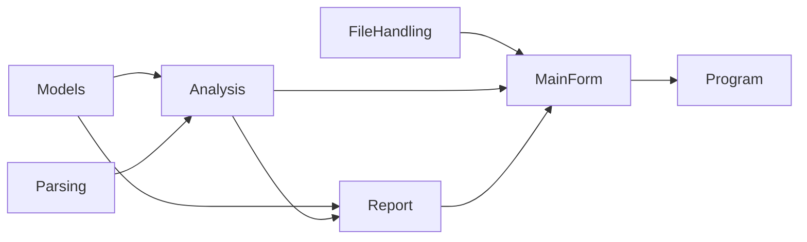

# Text Analyzer

A desktop application written in **F#** that analyzes text and reports detailed statistics: word, sentence and paragraph counts, word frequencies, and readability measures. Text can be typed or pasted directly, or loaded from a `.txt` file.


## Features

| Area | What you get |
|---|---|
| **Input** | Type or paste text, open a `.txt` file, or drag and drop a file onto the editor |
| **Counts** | Words, sentences, paragraphs, lines, characters (with and without spaces), unique words |
| **Word frequency** | Top-N most frequent words with rank, count, and a share-of-all-words bar |
| **Readability** | Average sentence length, average word length, readability level, Flesch Reading Ease (English) |
| **Extra insights** | Lexical diversity, longest word, longest sentence, words per paragraph, estimated reading time |
| **Filters** | Number of top words, minimum word length, ignore common words, ignore numbers |
| **Output** | Overview cards, frequency table, plain-text report, report export to `.txt`, frequency export to `.csv` |
| **Usability** | Live analysis while typing, live status bar counters, keyboard shortcuts |
| **Languages** | Works with English and Arabic text (Arabic question mark is recognized as a sentence end) |

## Getting started

### Requirements

- Windows 10 or later
- [.NET 8 SDK](https://dotnet.microsoft.com/download)

### Run

```powershell
git clone <repository-url>
cd TextAnalyzer
dotnet run
```

You can also open `TextAnalyzer.fsproj` in Visual Studio and press `F5`.

### Keyboard shortcuts

| Shortcut | Action |
|---|---|
| `Ctrl + O` | Open a text file |
| `Ctrl + S` | Save the report |
| `F5` | Analyze the text |

## Project structure

Files are listed in compilation order. Each source file has its own feature branch.

| File | Branch | Responsibility |
|---|---|---|
| `Models.fs` | `feature/models` | Records describing options, word counts, and the analysis result |
| `FileHandling.fs` | `feature/file-handling` | Reading and writing files with `System.IO`, returning `Result` values |
| `Parsing.fs` | `feature/parsing` | Splitting text into words, sentences, and paragraphs using sequences and pattern matching |
| `Analysis.fs` | `feature/analysis` | Counting, word frequency, readability metrics |
| `Report.fs` | `feature/report` | Formatting results for the UI, the text report, and CSV export |
| `MainForm.fs` | `feature/gui` | Windows Forms user interface |
| `Program.fs` | `feature/program` | Application entry point |



## How it works

### Parsing

Text is processed as lazy F# sequences (`seq { ... }`), so it is parsed in a single pass without building intermediate collections.

- **Words**: a run of letters, digits, or apostrophes. Matching on the character class decides whether to extend the current word or emit it.
- **Sentences**: terminated by `!`, `?`, `…`, the Arabic question mark `؟`, or a period followed by whitespace or the end of the text. Periods inside numbers (`3.14`) or identifiers (`app.db.base`) do not end a sentence.
- **Paragraphs**: blocks separated by one or more blank lines.

### Readability

- **Average sentence length** = words / sentences. The readability level is chosen with pattern matching:

| Average sentence length | Level |
|---|---|
| up to 10 words | Very easy |
| up to 15 words | Easy |
| up to 20 words | Moderate |
| up to 25 words | Hard |
| more than 25 words | Very hard |

- **Flesch Reading Ease** (English text only):

```
206.835 - 1.015 * (words / sentences) - 84.6 * (syllables / words)
```

Syllables are estimated by counting vowel groups with a silent-`e` adjustment. For non-English text the score is shown as `N/A`.

### Word frequency

Words are lower-cased, filtered according to the selected options, grouped with `Seq.countBy`, and sorted by count (descending) and then alphabetically. The share of each word is calculated against the total number of words in the text.

## F# concepts used

- Sequences and lazy evaluation (`seq`, `Seq.countBy`, `Seq.filter`, `Seq.truncate`)
- Pattern matching (character classes, readability levels, `Result` and `option` handling)
- Records and immutable data
- `Result` for error handling in file operations
- `option` for values that may be absent (Flesch score)
- Pipelines (`|>`) and function composition
- Modules for separating responsibilities

